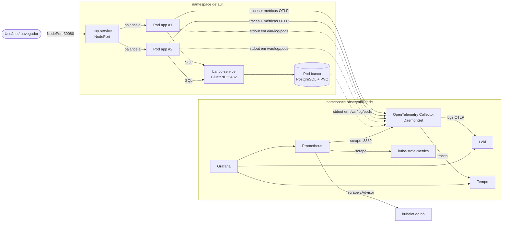
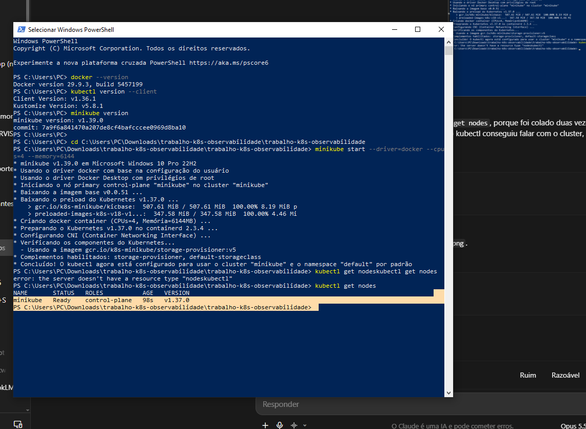
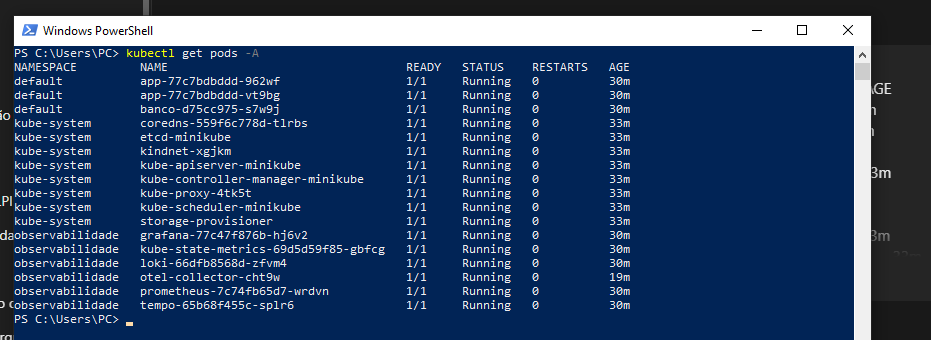
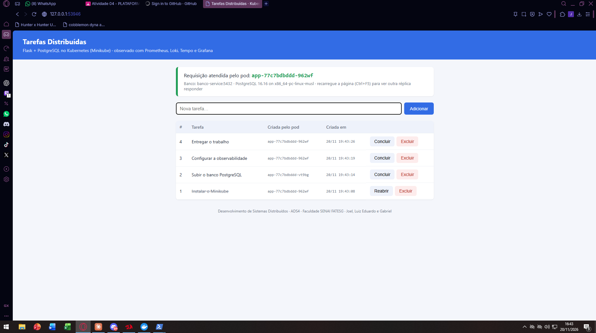
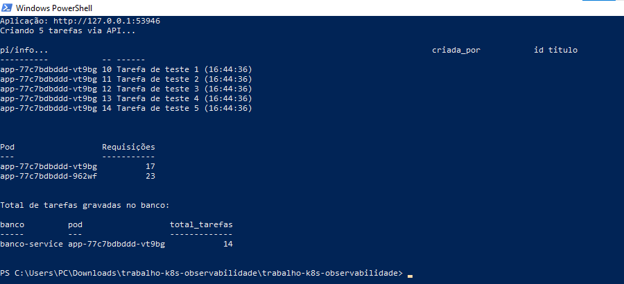
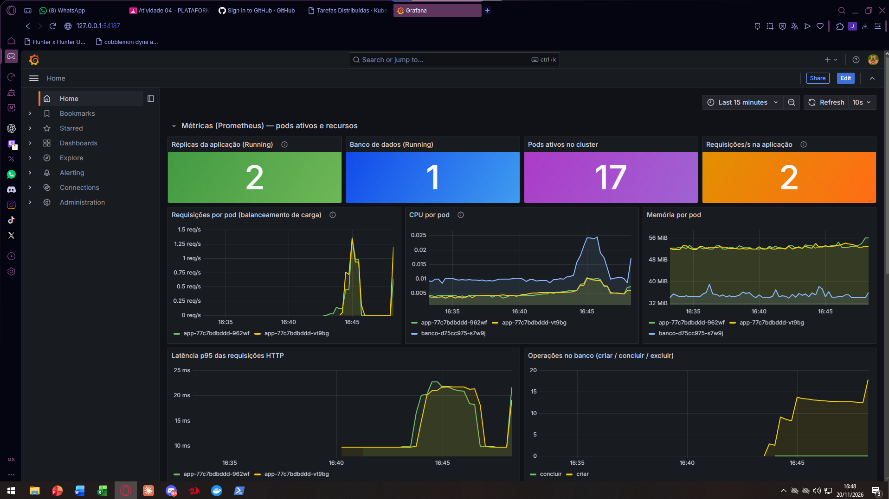
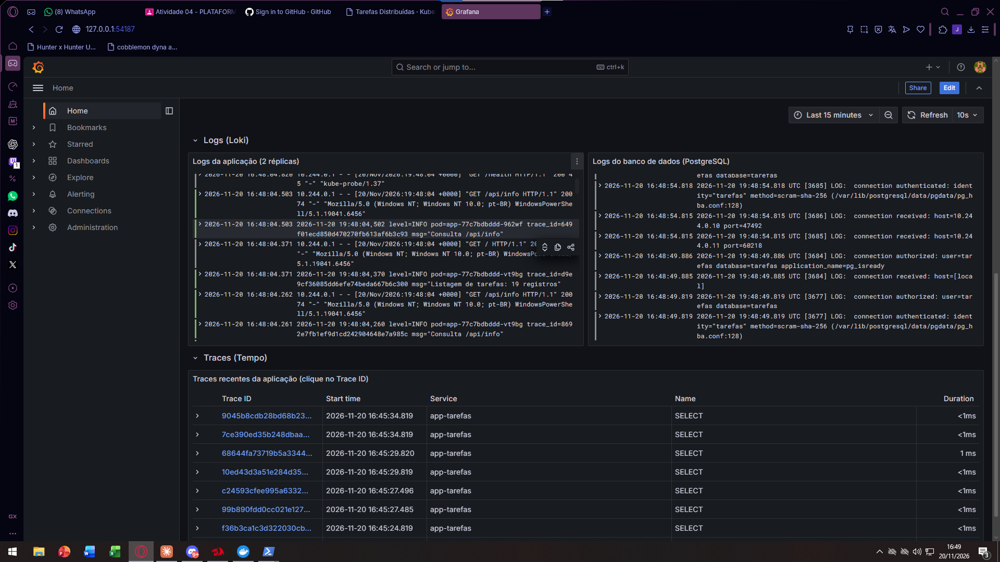
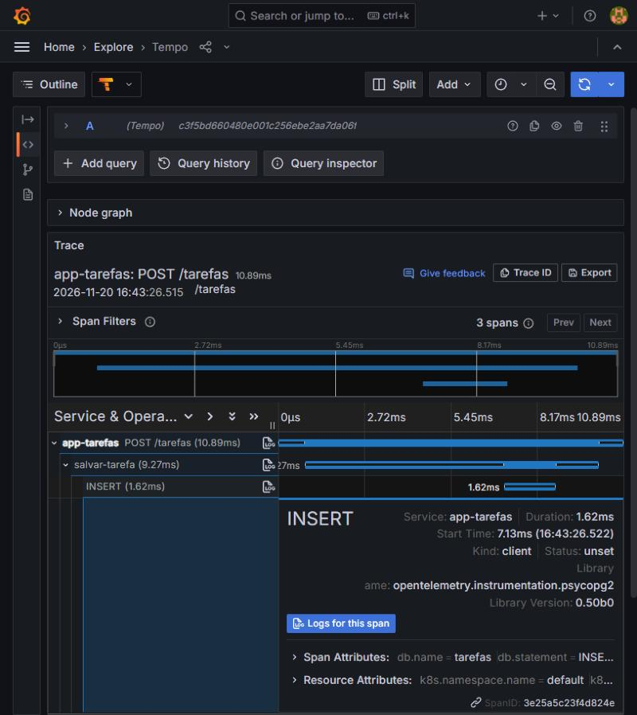

# Tarefas Distribuídas — Kubernetes (Minikube) + Observabilidade

> **Disciplina:** Desenvolvimento de Sistemas Distribuídos · **Curso:** Análise e Desenvolvimento de Sistemas (ADS4) · **Faculdade SENAI FATESG**
>
> **Grupo:**
> - Joel Felipe dos Santos Gonçalves
> - Luiz Eduardo Pageu Leite
> - Gabriel Ribeiro

Aplicação web replicada no Kubernetes, conectada a um banco PostgreSQL e monitorada por uma stack completa de observabilidade: **Prometheus** (métricas), **Loki** (logs), **Tempo** (traces), **OpenTelemetry** (coleta) e **Grafana** (dashboards).

📦 **Instalação passo a passo:** [INSTALL.md](INSTALL.md)

---

## Sumário

1. [A aplicação](#1-a-aplicação)
2. [Arquitetura da solução](#2-arquitetura-da-solução)
3. [Estrutura do repositório](#3-estrutura-do-repositório)
4. [Como executar (resumo dos comandos)](#4-como-executar-resumo-dos-comandos)
5. [Funcionalidades e operações no banco](#5-funcionalidades-e-operações-no-banco)
6. [Replicação e balanceamento de carga](#6-replicação-e-balanceamento-de-carga)
7. [Observabilidade](#7-observabilidade)
8. [Evidências](#8-evidências)
9. [Atendimento aos critérios de avaliação](#9-atendimento-aos-critérios-de-avaliação)

---

## 1. A aplicação

**Tarefas Distribuídas** é uma lista de tarefas (to-do) desenvolvida pelo grupo em **Python/Flask** com banco **PostgreSQL 16**. Escrevemos uma aplicação própria, em vez de usar WordPress ou Ghost, por dois motivos:

- **Mostrar qual réplica atendeu cada requisição.** O topo de toda página mostra o nome do pod, e cada tarefa grava o pod que a criou. Assim o balanceamento entre as 2 réplicas aparece na própria tela.
- **Telemetria completa com OpenTelemetry.** A aplicação é instrumentada com o SDK do OpenTelemetry: cada requisição HTTP gera um *trace* com os *spans* das queries SQL, além de métricas próprias (requisições por pod, operações no banco).

| Item | Tecnologia |
|---|---|
| Linguagem / framework | Python 3.12 · Flask 3.1 · Gunicorn |
| Banco de dados | PostgreSQL 16 (Alpine) |
| Instrumentação | OpenTelemetry SDK 1.29 (Flask + psycopg2) |
| Orquestração | Kubernetes via Minikube |
| Observabilidade | Prometheus 2.55 · Loki 3.3 · Tempo 2.6 · OTel Collector 0.120 · Grafana 11.4 |

## 2. Arquitetura da solução



**Fluxo de telemetria:**

| Sinal | Origem | Caminho | Destino | No Grafana |
|---|---|---|---|---|
| **Métricas** | SDK OTel na app | OTLP → Collector → endpoint `/metrics` | Prometheus | req/s por pod, latência, operações |
| **Métricas** | kube-state-metrics e kubelet (cAdvisor) | scrape direto | Prometheus | pods Running, CPU, memória |
| **Logs** | stdout da app e do PostgreSQL | arquivos do nó → Collector (`filelog`) → OTLP | Loki | logs por pod |
| **Traces** | SDK OTel na app (Flask + SQL) | OTLP → Collector | Tempo | requisições e queries rastreadas |

Os logs da aplicação incluem o `trace_id`. No Grafana, um clique no log abre o trace correspondente no Tempo, e o trace leva de volta aos logs do pod.

## 3. Estrutura do repositório

```
.
├── README.md                     # este arquivo: solução, funcionalidades e evidências
├── INSTALL.md                    # instalação do Minikube e implantação passo a passo
├── app/                          # código-fonte da aplicação
│   ├── app.py                    # Flask + PostgreSQL + OpenTelemetry
│   ├── templates/index.html      # interface web
│   ├── requirements.txt
│   └── Dockerfile
├── k8s/                          # manifestos Kubernetes
│   ├── banco-secret.yaml         # credenciais do PostgreSQL
│   ├── banco-pvc.yaml            # volume persistente do banco
│   ├── banco-deployment.yaml     # PostgreSQL (1 réplica)
│   ├── banco-service.yaml        # ClusterIP :5432  (DB_HOST=banco-service)
│   ├── app-deployment.yaml       # aplicação com replicas: 2
│   ├── app-service.yaml          # NodePort :30080
│   └── observabilidade/          # stack de observabilidade (YAML puro, sem Helm)
│       ├── 00-namespace.yaml
│       ├── 01-kube-state-metrics.yaml
│       ├── 02-prometheus.yaml
│       ├── 03-loki.yaml
│       ├── 04-tempo.yaml
│       ├── 05-otel-collector.yaml
│       ├── 06-grafana.yaml
│       └── 07-grafana-dashboard.yaml
├── scripts/
│   ├── subir-tudo.sh             # sobe tudo do zero
│   ├── gerar-trafego.sh / .ps1   # gera tráfego e mostra a distribuição entre pods
│   └── limpar.sh
└── docs/evidencias/              # capturas de tela
```

Todos os arquivos YAML e de código têm o nome do grupo no cabeçalho, em comentário.

## 4. Como executar (resumo dos comandos)

O detalhamento, incluindo a instalação do Docker e do Minikube no Windows, Linux e macOS, está no **[INSTALL.md](INSTALL.md)**.

```bash
# Etapa 1 — cluster
minikube start --driver=docker --cpus=4 --memory=6144
kubectl get nodes

# imagem da aplicação (construída dentro do Minikube)
minikube image build -t tarefas-app:1.0 ./app

# Etapa 2 — banco de dados
kubectl apply -f k8s/banco-secret.yaml
kubectl apply -f k8s/banco-pvc.yaml
kubectl apply -f k8s/banco-deployment.yaml
kubectl apply -f k8s/banco-service.yaml

# Etapa 4 — observabilidade (Prometheus, Loki, Tempo, OTel Collector, Grafana)
kubectl apply -f k8s/observabilidade/

# Etapa 3 — aplicação com 2 réplicas
kubectl apply -f k8s/app-deployment.yaml
kubectl apply -f k8s/app-service.yaml
kubectl get pods

# Etapa 5 — acesso
minikube service app-service --url
minikube service grafana -n observabilidade --url     # admin / admin123
```

## 5. Funcionalidades e operações no banco

### Interface web

| Ação | O que acontece no banco |
|---|---|
| Abrir a página | `SELECT` em todas as tarefas + `SELECT version()` |
| **Adicionar** tarefa | `INSERT` com o título e o nome do pod que a criou |
| **Concluir / Reabrir** | `UPDATE ... SET concluida = NOT concluida` |
| **Excluir** | `DELETE` |

A tabela `tarefas` é criada automaticamente quando os pods sobem. Como as duas réplicas iniciam juntas, a criação usa um *advisory lock* do PostgreSQL para que só uma execute o `CREATE TABLE` por vez.

### API REST

| Método | Rota | Descrição |
|---|---|---|
| `GET` | `/api/tarefas` | lista as tarefas e informa o pod que respondeu |
| `POST` | `/api/tarefas` | cria uma tarefa — corpo `{"titulo": "..."}` |
| `GET` | `/api/info` | pod que atendeu + total de tarefas no banco |
| `GET` | `/health` | usado pelas probes do Kubernetes (só fica pronto se o banco responder) |

```bash
URL=$(minikube service app-service --url)
curl -X POST $URL/api/tarefas -H "Content-Type: application/json" -d '{"titulo":"Estudar Kubernetes"}'
curl $URL/api/tarefas
```

### Persistência

Os dados ficam num **PersistentVolumeClaim**. Para provar, apague o pod do banco: o Kubernetes recria o pod e as tarefas continuam lá.

```bash
kubectl delete pod -l app=banco
kubectl get pods -w
```

### Conexão app → banco

A aplicação encontra o banco pelo DNS interno do Kubernetes, configurado por variáveis de ambiente no `app-deployment.yaml`:

```yaml
- name: DB_HOST
  value: banco-service          # Service ClusterIP do PostgreSQL
- name: DB_PASSWORD
  valueFrom:
    secretKeyRef: { name: banco-secret, key: POSTGRES_PASSWORD }
```

## 6. Replicação e balanceamento de carga

- O `app-deployment.yaml` declara **`replicas: 2`**. Se um pod for apagado, o Deployment cria outro na hora (`kubectl delete pod <pod-app>`).
- O `app-service.yaml` (**NodePort 30080**) distribui as conexões entre as réplicas.
- As *readiness probes* só colocam um pod no balanceamento depois que ele consegue falar com o banco.

**Como comprovar:**

1. No navegador: recarregue com **Ctrl+F5** e veja o campo *"Requisição atendida pelo pod"* mudar. A coluna *"Criada pelo pod"* mostra tarefas gravadas por réplicas diferentes.
2. No terminal: `./scripts/gerar-trafego.sh <URL> 40` conta quantas requisições cada pod atendeu:
   ```
     app-6c9b8f7d4-7xk2p        21 requisições
     app-6c9b8f7d4-qm9zt        19 requisições
   ```
3. No Grafana: o painel **"Requisições por pod (balanceamento de carga)"** mostra uma linha para cada réplica.

## 7. Observabilidade

Toda a stack está em YAML puro dentro de [`k8s/observabilidade/`](k8s/observabilidade/), para que cada configuração possa ser lida e conferida diretamente.

| Componente | Papel | Onde está configurado |
|---|---|---|
| **OpenTelemetry SDK** | instrumenta a app: span por requisição HTTP e por query SQL, métricas próprias | `app/app.py` |
| **OpenTelemetry Collector** | recebe traces e métricas via OTLP (4317/4318), lê os logs dos pods do nó e envia cada sinal ao seu destino | `05-otel-collector.yaml` |
| **Prometheus** | coleta métricas do Collector, do kube-state-metrics e do kubelet (cAdvisor) | `02-prometheus.yaml` |
| **kube-state-metrics** | expõe o estado dos pods (Running/Pending, réplicas) | `01-kube-state-metrics.yaml` |
| **Loki** | armazena e indexa os logs da app e do PostgreSQL | `03-loki.yaml` |
| **Tempo** | armazena os traces distribuídos | `04-tempo.yaml` |
| **Grafana** | fontes de dados e dashboard já provisionados | `06-grafana.yaml`, `07-grafana-dashboard.yaml` |

### Dashboard "Tarefas Distribuídas — Kubernetes + Observabilidade"

Abre automaticamente como página inicial do Grafana.

| Seção | Painel | Fonte | Consulta |
|---|---|---|---|
| Métricas | Réplicas da aplicação (Running) | Prometheus | `sum(kube_pod_status_phase{namespace="default", pod=~"app-.*", phase="Running"})` |
| Métricas | Banco de dados (Running) | Prometheus | `sum(kube_pod_status_phase{namespace="default", pod=~"banco-.*", phase="Running"})` |
| Métricas | Pods ativos no cluster | Prometheus | `sum(kube_pod_status_phase{phase="Running"})` |
| Métricas | Requisições por pod (balanceamento) | Prometheus | `sum by (k8s_pod_name) (rate(app_requisicoes_total[1m]))` |
| Métricas | CPU por pod | Prometheus | `rate(container_cpu_usage_seconds_total{namespace="default"}[2m])` |
| Métricas | Memória por pod | Prometheus | `container_memory_working_set_bytes{namespace="default"}` |
| Métricas | Latência p95 HTTP | Prometheus | `histogram_quantile(0.95, ... http_server_duration_milliseconds_bucket ...)` |
| Logs | Logs da aplicação (2 réplicas) | Loki | `{k8s_namespace_name="default", k8s_container_name="app"}` |
| Logs | Logs do banco (PostgreSQL) | Loki | `{k8s_namespace_name="default", k8s_container_name="postgres"}` |
| Traces | Traces recentes da aplicação | Tempo | `{resource.service.name="app-tarefas"}` |

### Exemplo de trace

Ao adicionar uma tarefa, o Tempo registra:

```
POST /tarefas                       ← span HTTP (Flask)
└── salvar-tarefa                   ← span manual com o título e o id da tarefa
    └── INSERT                      ← span SQL (psycopg2) com a query executada
```

### Correlação entre os três sinais

- **Log → Trace:** no painel de logs, expanda uma linha com `trace_id=...` e clique em **"Ver trace no Tempo"**.
- **Trace → Logs:** dentro de um trace, o ícone de logs abre no Loki as linhas daquele pod com aquele `trace_id`.

## 8. Evidências

> As capturas ficam em [`docs/evidencias/`](docs/evidencias/).

### 8.1 Cluster Minikube ativo — `kubectl get nodes`



### 8.2 `kubectl get pods` — 2 réplicas da aplicação + banco rodando



### 8.3 Stack de observabilidade rodando — `kubectl get pods -n observabilidade`


### 8.4 Aplicação funcionando no navegador



### 8.5 Balanceamento de carga entre as réplicas



### 8.6 Grafana — métricas do Prometheus



### 8.7 Grafana — logs do Loki



### 8.8 Grafana — traces do Tempo



## 9. Atendimento aos critérios de avaliação

| Critério | Pontos | Onde conferir |
|---|---|---|
| Instalação e conexão no Minikube | 20 | [INSTALL.md](INSTALL.md) · evidência 8.1 |
| Aplicação replicada e banco de dados | 30 | `k8s/app-deployment.yaml` (`replicas: 2`, `DB_HOST=banco-service`) · `k8s/banco-*.yaml` · evidência 8.2 |
| Exposição e funcionamento da aplicação | 20 | `k8s/app-service.yaml` (NodePort) · seções 5 e 6 deste README · evidências 8.4 e 8.5 |
| Stack de observabilidade (PLG + OTel + Tempo) | 20 | `k8s/observabilidade/*.yaml` · seção 7 · evidências 8.6 a 8.8 |
| Organização do repositório e documentação | 10 | estrutura da seção 3 · README.md · INSTALL.md · evidências |
